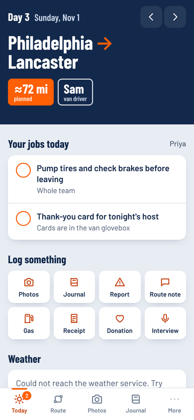
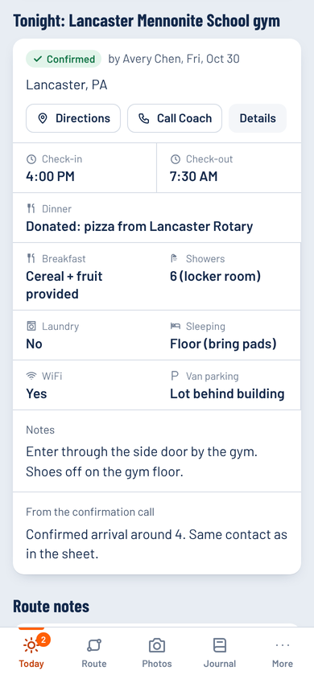
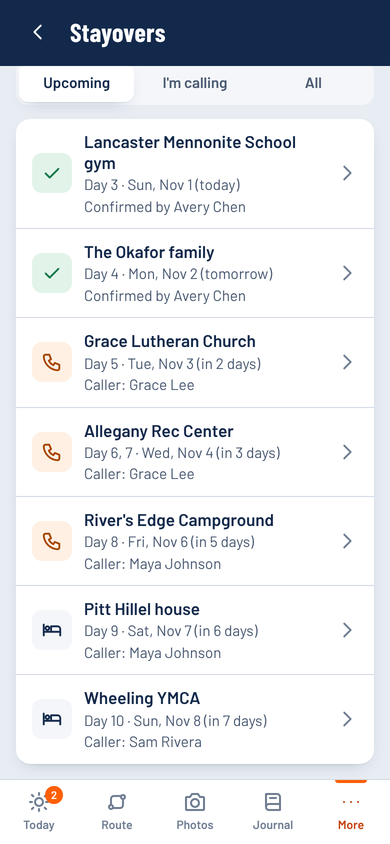
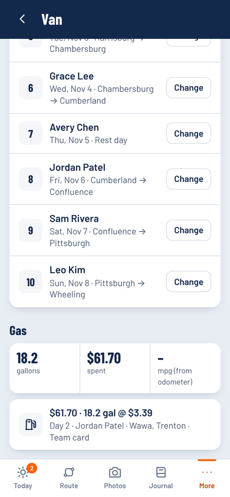

# Illini 4000 Ride Day

The team's phone app for the summer ride. Open it in the morning and it shows the day: route and mileage, weather and wind, who's driving the van, tonight's stayover (food, showers, check-in time, whether it's confirmed), and the jobs assigned to you. During the day everyone logs photos, journals, check-ins, route comments, gas, receipts, donations and portrait interviews, and it all lands in one Google Sheet and organised Google Drive folders.

Works on iPhone and Android with no app store: it installs from the browser to the home screen. It keeps working without signal and uploads later.

**Open the app:** https://ehsanhomaee.github.io/illini4000-ride-app/ (runs as a demo until the team's Google Sheet is connected)

<p>




</p>

## What it does

| | |
|---|---|
| **Today** | Day number, from → to, miles (planned first, then exact miles and climbing from RideWithGPS), weather at start and finish with headwind/tailwind, van driver, tonight's stayover, route notes and notes from last year's riders. |
| **Your jobs** | Sign in by name. The app lists what's yours today: driving, a stayover to call, adding the route, blog post, sweep… and sends a morning reminder by email or phone notification. |
| **Stayovers** | Address, directions, host contact, check-in/out, dinner/breakfast donations, showers, laundry, sleeping, WiFi, van parking. Each has a caller; anything arriving in the next 5 days that isn't confirmed shows up as a call to make, with a tick when done. |
| **Van** | Driver rotation, swap with someone (they get notified), gas log with gallons, price and receipt photo, MPG, and an accident report form. |
| **Photos** | Upload from the camera or library. Saved per day in Drive (`Photos & Videos/Day 05 – …`) and shown by day or all together. Videos upload in pieces and resume. |
| **Journal** | Team journal, a private journal, or "this phone only" entries. |
| **Check-in** | "I left", "I arrived", "In the van" with optional location, and a board of who has arrived. Leaders log the team's stayover check-in/out times. |
| **Reports** | Route issues and comments, stayover comments, bike problems, injuries, van accidents (leaders are alerted). Route comments become next year's "notes from previous riders". |
| **Rider forms** | Leaders list the paperwork (liability waiver, media release, insurance card, medical info…). Each rider uploads a photo or PDF of theirs; leaders approve it or ask for a new copy, and see who's still missing what. Kept in a private folder only leaders can open. |
| **Receipts & donations** | Receipts with photo, category and who to reimburse; donations with donor, amount, what was given, and thank-you tracking. Saved to separate Drive folders. |
| **Portrait interviews** | Record audio in the app, add video, portraits and the signed release. One Drive folder per person. |

## How it's built

```
 phones (installed web app, works offline)
        │  JSON over HTTPS
        ▼
 Google Apps Script web app  ──  backend/Code.gs
        │
        ├── Google Sheet: the master file (Itinerary, Stayovers, Riders, Duties, and a tab per log)
        ├── Google Drive: Photos & Videos (by day) · Receipts · Donations · Portrait Interviews · Reports
        ├── RideWithGPS: reads route miles and climbing
        └── Email / ntfy.sh: morning reminders
```

- **App:** React + TypeScript + Vite, hosted free on GitHub Pages. Offline outbox in IndexedDB; a service worker caches the app.
- **Backend:** one Apps Script file bound to the Google Sheet. Leaders edit the plan directly in the sheet.
- **Weather:** [Open-Meteo](https://open-meteo.com) (free, no key).
- **No accounts to manage:** riders pick their name, type the team code once, and choose a PIN.

## Try it

The app runs in **demo mode** with made-up riders and stops until a backend is connected. Team code: `demo`, any name, any 4-digit PIN.

```bash
npm install
npm run dev        # open the printed address on your phone (same Wi-Fi)
```

## Set it up for the real trip

1. **[docs/SETUP.md](docs/SETUP.md)**: one-time setup for a leader (Google Sheet + Apps Script + GitHub Pages, about 30 minutes).
2. **[docs/SHEET-GUIDE.md](docs/SHEET-GUIDE.md)**: what goes in each tab of the master sheet.
3. **[docs/INSTALL-ON-PHONE.md](docs/INSTALL-ON-PHONE.md)**: send this to riders. Install on iPhone or Android and turn on reminders.

## Project layout

```
backend/Code.gs            Apps Script backend (paste into the sheet's script editor)
backend/appsscript.json    its manifest: time zone and permissions
public/config.json         the one file to edit after deploying: backend URL + team name
src/screens/               Today/Day, Route, Photos, Journal, Stayovers, Van, Money, Interviews, More
src/components/forms.tsx   every "add something" form
src/lib/sync.ts            offline outbox and resumable uploads
src/lib/store.ts           signed-in user, master data, cached lists
src/api/demo.ts            demo backend that runs on the phone
```

MIT licensed.
